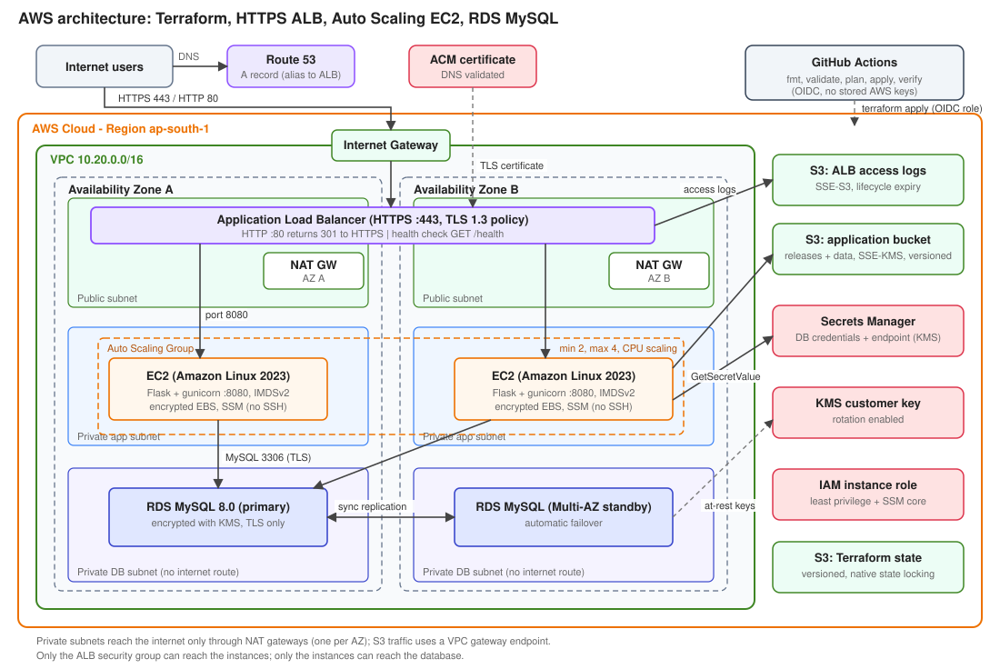
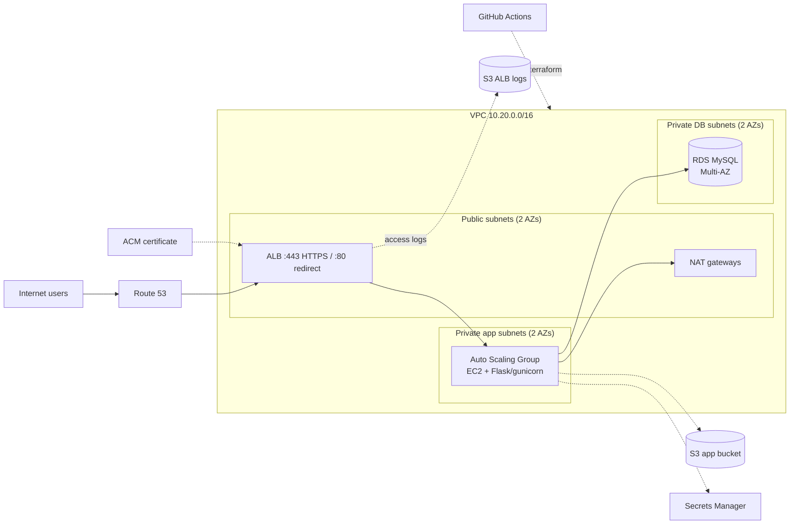

# AWS Infrastructure & CI/CD with Terraform and GitHub Actions

A highly available web application on AWS, defined entirely as code and deployed by a GitHub Actions
pipeline.

```
Internet -> Route 53 -> Application Load Balancer (HTTPS) -> Auto Scaling EC2 (2 AZs) -> RDS MySQL (Multi-AZ)
                                  |
                                  +-> S3 (access logs)
```



<details>
<summary>Diagram as Mermaid (renders on GitHub)</summary>


</details>

## What is deployed

| Area | Implementation | File |
| --- | --- | --- |
| Network | VPC, 3 subnet tiers x 2 AZs (public, private app, private DB), route tables, Internet Gateway, one NAT Gateway per AZ, S3 gateway endpoint | `terraform/vpc.tf` |
| Compute | Launch Template (AL2023, IMDSv2, encrypted gp3 root volume) + Auto Scaling Group across 2 private subnets, ELB health checks, CPU target tracking, rolling instance refresh | `terraform/asg.tf` |
| Load balancing | Internet-facing ALB, HTTPS listener with ACM certificate and TLS 1.3 policy, HTTP -> HTTPS 301, access logs to S3 | `terraform/alb.tf` |
| Database | RDS MySQL 8.0 in private DB subnets, Multi-AZ, KMS encryption, TLS enforced, 7-day backups | `terraform/database.tf` |
| Secrets | DB password generated by Terraform, stored with endpoint in Secrets Manager (KMS); the app reads it at runtime | `terraform/database.tf` |
| IAM | EC2 role limited to one secret, one KMS key and two S3 prefixes, plus SSM for shell access (no SSH) | `terraform/iam.tf` |
| Security groups | Internet -> ALB (80/443) -> app (8080 from ALB only) -> DB (3306 from app only) | `terraform/security_groups.tf` |
| Storage | App bucket (SSE-KMS, versioned) and ALB log bucket (SSE-S3, lifecycle), both private with TLS-only policies | `terraform/s3.tf` |
| CI/CD | fmt, validate, tflint, plan on PR (commented), apply with approval gate, automatic end-to-end validation, manual destroy | `.github/workflows/terraform.yml` |
| Bootstrap | State bucket + GitHub OIDC role (no long-lived AWS keys) | `bootstrap/main.tf` |
| Application | Flask app with `/health`, `/db-health`, `/storage-check`, `/api/status` | `app/app.py` |

## Repository layout

```
app/                 Flask application source (packaged to S3 by Terraform)
terraform/           Main infrastructure stack
bootstrap/           One-time state bucket + GitHub OIDC role
scripts/             validate-deployment.sh (HTTPS, health, DB, S3 checks)
.github/workflows/   terraform.yml pipeline
docs/                Architecture diagram, deployment guide, screenshot checklist
```

## How a request flows

1. DNS (Route 53 alias) resolves to the ALB; ACM provides the certificate.
2. The ALB terminates TLS 1.3/1.2 in public subnets and forwards plain HTTP on 8080 to healthy
   instances in the private subnets of both AZs.
3. Each instance reads the DB credentials from Secrets Manager with its IAM role, connects to RDS over
   verified TLS, and stores a visit row; it also writes a heartbeat object to the app bucket.
4. ALB access logs are delivered to the log bucket.

## Security and best practices

| Requirement | How it is met |
| --- | --- |
| Encryption at rest | RDS + app bucket + secret use a rotating KMS key; EBS volumes encrypted; ALB logs and state bucket use SSE-S3 |
| HTTPS-only access | HTTP listener only redirects; TLS 1.3 policy; HSTS header from the app; S3 buckets deny non-TLS requests |
| Secrets Manager | Credentials never appear in code, user data or env files (only the secret name is passed) |
| Least-privilege IAM | Scoped instance role; CI role limited to the services used, IAM restricted to `<project>-<env>-*` and only the SSM managed policy attachable |
| Private database | Private subnets with no internet route, `publicly_accessible = false`, reachable only from the app security group |
| Restricted security groups | Source-by-security-group rules, no SSH anywhere, DB group has no egress |
| No shared credentials | GitHub OIDC to AWS, IMDSv2 required on instances, Session Manager instead of SSH |
| IaC end to end | Everything, including the pipeline's own role, is Terraform; remote state is encrypted, versioned and locked |

## High availability

* Subnets, ALB nodes, instances and RDS standby are spread over two AZs (`az_count` can be 3).
* One NAT gateway per AZ, so an AZ failure does not cut egress for the other (`single_nat_gateway = true` trades this for cost).
* ASG replaces unhealthy instances (ELB health checks); RDS Multi-AZ fails over automatically.

## Design decisions

* **Release delivery through S3** keeps instances independent from GitHub; the code hash in the launch template makes every app change a safe rolling refresh.
* **`/health` does not touch the database**, so a database problem cannot drain the whole fleet; `/db-health` is the readiness signal checked by the pipeline.
* **Apply re-plans instead of reusing a plan file** because plan files contain secret values and would need to be stored as artifacts.
* **Password generated by Terraform** (stored in an encrypted state bucket) was chosen over RDS-managed passwords so the secret can also carry host, port and database name in one JSON document.

## Cost (approximate, ap-south-1, running 24x7)

Two NAT gateways, a Multi-AZ RDS instance, an ALB and two t3.micro instances are the main items, roughly
USD 120-150 per month. For a demo, set `single_nat_gateway = true` and `db_multi_az = false`, and run the
**destroy** workflow when finished.

## Hardening ideas beyond the scope of this task

Separate read-only role for PR plans, permission boundary on the CI role, WAF on the ALB, VPC flow logs,
CloudWatch alarms and dashboards, automatic secret rotation, interface VPC endpoints for Secrets Manager/KMS
to drop the NAT dependency, and container/AMI image pipelines.

See [docs/DEPLOYMENT.md](docs/DEPLOYMENT.md) for step-by-step instructions and
[docs/screenshots/CHECKLIST.md](docs/screenshots/CHECKLIST.md) for the screenshots to capture.
